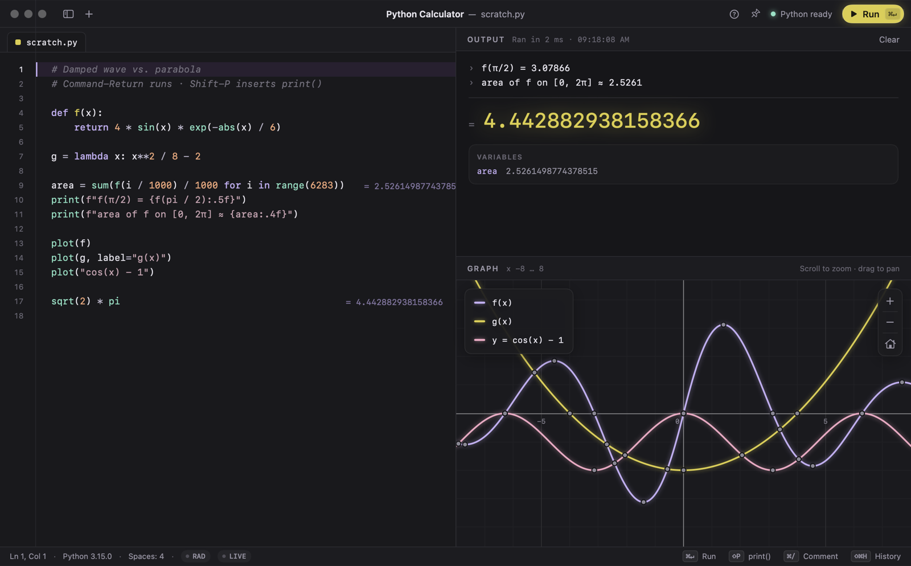
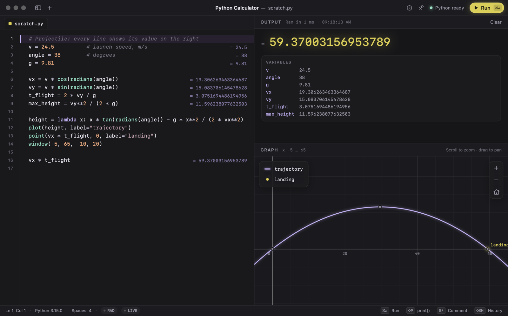
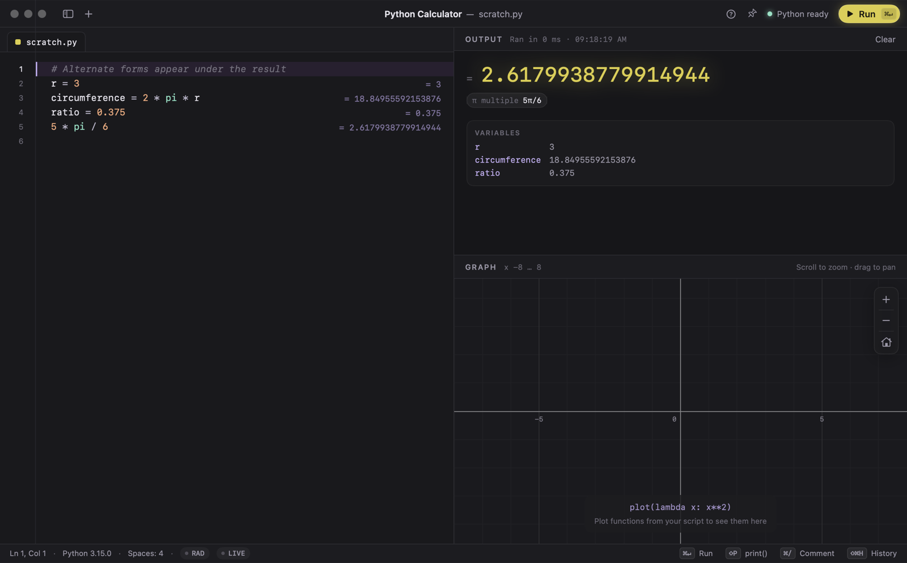
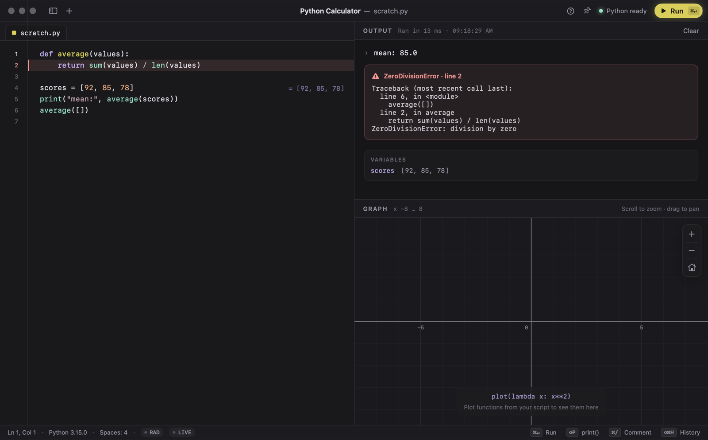
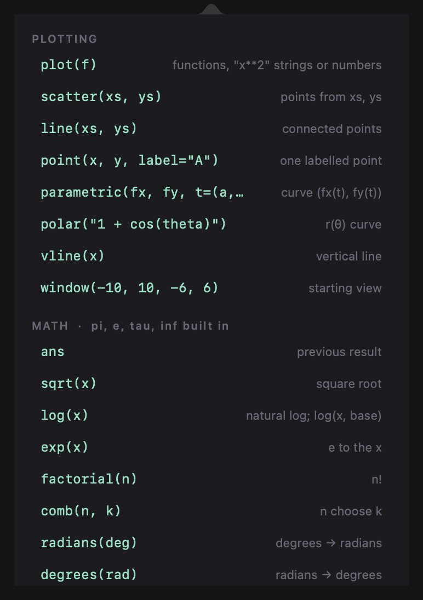
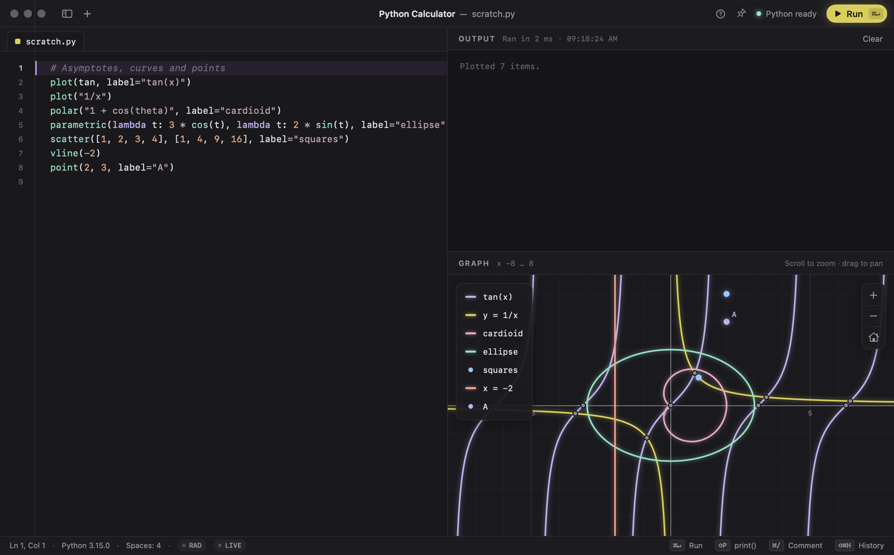
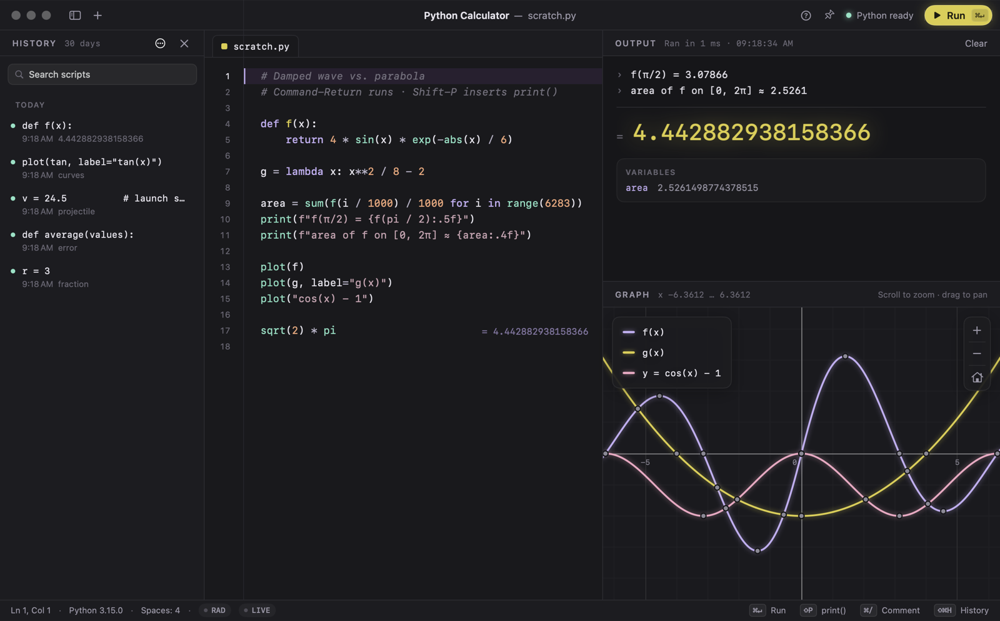

# Python Calculator

A native macOS calculator where the input is Python. Write a few lines on the left. The answer appears on the right in large type, like a calculator display, and anything you plot shows up on an interactive, Desmos-style graph underneath.



- **Python as the input.** All of `math` is preloaded, and `ans` holds your previous result.
- **Calculator-style feedback.** The final value is shown large, every line shows its own result, and alternate number forms and a variables list appear under the result.
- **A real graphing view.** You get smooth zoom and pan with momentum, and Python re-samples curves as you move so they stay sharp. Roots, extrema and intersections are marked, and you can hover to trace a curve.
- **Native and fast.** Built with SwiftUI and AppKit, with a long-lived Python process behind it. There is no Electron and no web view.
- **30-day history** of everything you run, searchable and one click to reopen.

---

## Contents

1. [Requirements](#requirements)
2. [Installation](#installation)
3. [A tour of the app](#a-tour-of-the-app)
4. [Writing calculations](#writing-calculations)
5. [Graphing](#graphing)
6. [History](#history)
7. [Keyboard shortcuts](#keyboard-shortcuts)
8. [Settings and options](#settings-and-options)
9. [Security and privacy](#security-and-privacy)
10. [Troubleshooting](#troubleshooting)
11. [Development](#development)
12. [License](#license)

---

## Requirements

| | |
|---|---|
| macOS | 14 Sonoma or later (Apple silicon) |
| Python | 3.9 or later. Homebrew's `python3` is preferred. The system `/usr/bin/python3` also works. |
| To build from source | Xcode Command Line Tools with Swift 6 (`xcode-select --install`) |

The app runs your scripts with an existing Python installation and does not bundle its own interpreter.

## Installation

### Option A: Download the disk image (recommended)

1. Download **`PythonCalculator-1.0.0.dmg`** from the [latest release](https://github.com/chase-bratt/pycalc/releases/latest).
2. Open the `.dmg` and drag **Python Calculator** onto the **Applications** shortcut.
3. Eject the disk image and open **Python Calculator** from Applications or Spotlight.

> **First launch:** the app is ad-hoc signed and not notarized by Apple, so macOS blocks it the first time. Try to open it once, then go to **System Settings ▸ Privacy & Security**, scroll down and click **Open Anyway**. (On macOS 14 you can instead right-click the app → **Open** → **Open**.) Alternatively, run:
>
> ```sh
> xattr -dr com.apple.quarantine "/Applications/Python Calculator.app"
> ```
>
> This is only needed once.

The download is a native Apple silicon build. It uses the Python already installed on your Mac, so make sure you have Python 3.9+ (`python3 --version`, or `brew install python`).

### Option B: Build from source

#### 1. Get the code

```sh
git clone https://github.com/chase-bratt/pycalc.git
cd pycalc
```

#### 2. Make sure Python 3 is installed

```sh
python3 --version          # 3.9 or newer
# If you don't have it:
brew install python
```

#### 3. Build the app

```sh
./scripts/build_app.sh             # builds dist/Python Calculator.app
./scripts/build_app.sh --install   # also copies it into /Applications
./scripts/make_dmg.sh              # builds the app and packages dist/PythonCalculator-<version>.dmg
```

The script compiles a release build, generates the app icon, assembles the `.app` bundle and signs it locally. Open **Python Calculator** from Applications or Spotlight.

> **First launch:** the app is signed on your machine and not notarized. If macOS warns about it, right-click the app → **Open** → **Open**. This is only needed once.

### Optional: NumPy and other packages

The calculator needs only the Python standard library. If you want NumPy available as `np`, or any other package inside your scripts, install it for the interpreter the app uses. The cleanest way is a dedicated virtual environment:

```sh
python3 -m venv ~/.pycalc-venv
~/.pycalc-venv/bin/pip install -r requirements.txt
defaults write app.pycalc.PythonCalculator pythonPath ~/.pycalc-venv/bin/python3
```

Relaunch the app and the status bar shows the new interpreter. Hover the Python version to see its full path. `requirements.txt` lists the optional runtime packages. `requirements-dev.txt` adds the test and lint tools for contributors.

---

## A tour of the app

| Area | What it does |
|---|---|
| **Title bar** | History sidebar toggle, new scratch (**+**), quick reference (**?**), float-on-top pin, Python status and the **Run** button. |
| **Editor** (left) | Python editor with syntax colouring, line numbers, auto-indent, bracket pairing and inline per-line results. |
| **Output** (top right) | Printed lines (each prefixed with `›`), then the script's final value in large type, its alternate forms, and the variables you defined. |
| **Graph** (bottom right) | Everything you plotted, with a legend, zoom controls and points of interest. |
| **Status bar** | Cursor position, Python version, the **DEG/RAD** and **LIVE** toggles, and shortcut hints. |

### Running a script

Press **⌘↵** (or click **Run**). Each run starts from a clean slate, so results never depend on an earlier run, with one exception: `ans`. If a script runs too long, **⌘.** stops it, and the editor highlights the line it was on.

### Inline results, alternate forms and variables



- **Inline results.** Every top-level expression and simple assignment (`x = …`) shows its value, dimmed, at the right edge of its line. Values fade when you edit, until the next run. Click one to copy it.
- **The big result.** If the last line is an expression, its value is shown large. Click it, or press **⇧⌘C**, to copy it.
- **Alternate forms.** Chips under the result show the same number another way: grouped (`1,234,567`), scientific, as a fraction (`3/8`), as a multiple of π (`5π/6`), in hex or binary for integers, and in polar form for complex numbers. Click a chip to copy that form.



- **Variables.** Every name your script defined is listed with its value. Click a **name** to insert it at the cursor, or click a **value** to copy it.

### Errors



When something goes wrong:
- The failing line is highlighted in the editor and its line number turns red.
- The output shows a traceback trimmed to your own code.
- Anything printed before the error stays visible.

### Live mode

Turn on **LIVE** in the status bar (or press **⌥⌘L**) and the script re-runs about half a second after you stop typing, much like Soulver or Desmos.
- Live runs are capped at 2 seconds, so a half-typed infinite loop can't hang the app.
- Live runs are not saved to history; only **⌘↵** saves a run.
- A live run never jumps the editor to an error.

### Quick reference

Click **?** in the title bar (or press **⇧⌘/**) for a cheat sheet of plotting helpers, common math functions and shortcuts. Click any entry to insert it with the cursor already in place.

<p align="center"></p>

### Float on top

Click the **pin** in the title bar (or press **⌥⌘T**) and the window stays above all other windows, including on other Spaces and next to full-screen apps. That makes it easy to keep the calculator beside whatever you're working on. The setting is remembered between launches.

---

## Writing calculations

Each script runs with the following already available:

| Name | Notes |
|---|---|
| Everything in `math` | `sqrt`, `sin`, `log`, `factorial`, `comb`, `pi`, `e`, `tau`, `inf`, … |
| `math`, `cmath` | The modules themselves |
| `ans` | The last result from a previous run (`None` at first) |
| `np` | NumPy, if installed (see [Optional: NumPy](#optional-numpy-and-other-packages)) |
| Plot helpers | `plot`, `scatter`, `line`, `point`, `parametric`, `polar`, `vline`, `window` |

```python
# Chain results like a calculator
19.99 * 3          # = 59.97
ans * 1.0825       # next run: = 64.91...

# Degrees mode (DEG in the status bar): sin(30) == 0.5
```

**Degrees vs radians.** Click **RAD/DEG** in the status bar (or press **⌥⌘D**). In degrees mode, `sin`, `cos` and `tan` take degrees, and `asin`, `acos`, `atan` and `atan2` return degrees. This applies to plots too. `math.sin` always uses radians.

**Editor conveniences**

| Action | How |
|---|---|
| Insert `print()` with the cursor inside, or wrap the selection | **⇧P** |
| Insert `plot()` | **⌥⌘P** |
| Complete a name (math functions, your variables, keywords) | **Esc** |
| Comment or uncomment lines | **⌘/** |
| Indent / outdent | **Tab** / **⇧Tab** |
| Auto-indent after `:` and bracket pairing | automatic |

> **⇧P** inserts `print()` only where a capital *P* couldn't be part of a name: not inside strings or comments, and not next to letters, digits, `_` or `.`. If you often type names that start with *P*, turn it off under **Script ▸ ⇧P Inserts print()**.

`input()` isn't available. Assign values in the script instead.

---

## Graphing



```python
plot(f)                                  # any function of x
plot(f, g, "x**2 - 1", 3)                # several at once: callables, strings, constants
plot(f, color="#7EE0C3", label="wave")   # custom colour and legend label
scatter([1, 2, 3], [1, 4, 9])            # points; or scatter([(x, y), ...])
line(xs, ys)                             # points joined by straight segments
point(2, 3, label="A")                   # a single labelled point
parametric(cos, sin, t=(0, 2*pi))        # (fx(t), fy(t))
polar("1 + cos(theta)")                  # r(θ); strings use the variable theta
vline(2)                                 # vertical line x = 2
window(-10, 10, -6, 6)                   # the view to start with
```

**Navigating**

| Gesture | Effect |
|---|---|
| Scroll / pinch | Zoom around the pointer |
| Drag | Pan, with momentum when you let go |
| Double-click | Zoom in at that spot |
| **+ / − / ⌂** buttons, **⌘= / ⌘- / ⌘0** | Zoom in, zoom out, reset the view |
| Two-finger double-tap | Reset the view |

**Reading the graph**
- Curves are re-sampled from Python as you move, so detail holds at any zoom level. Discontinuities like `tan(x)` or `1/x` are not joined by fake vertical lines.
- **Grey dots** mark roots, minima, maxima, y-intercepts and intersections between curves. Hover a dot to read its coordinates, or click it to pin the label.
- Hover near any curve to trace it.
- Click a legend entry to hide or show that plot. Hidden plots stay hidden when you re-run.

**Right-click menu:** *Copy Point* (the dot or curve under the pointer), *Copy Image*, *Save as PNG…*, *Show All Plots* and *Reset View*.

---

## History



Every script you run with **⌘↵** is saved, so nothing is lost.

- Open the sidebar with **⇧⌘H**, or with the sidebar button in the title bar.
- Runs are grouped by day. Search filters by script contents.
- Click an entry to load it into the editor. **⌘Z** brings back what you had before.
- Right-click an entry to **Copy Script** or **Delete** it.
- Running an identical script again moves it to the top instead of adding a duplicate.
- Entries older than **30 days** are deleted automatically.
- The **⋯** menu can pause saving (**Save Runs to History**) or **Clear All History…**.

History is stored locally at `~/Library/Application Support/PyCalc/history.sqlite`, readable only by your user account.

---

## Keyboard shortcuts

| Shortcut | Action |
|---|---|
| **⌘↵** | Run |
| **⌘.** | Stop the running script |
| **⌥⌘L** | Live mode on/off |
| **⌥⌘D** | Degrees / radians |
| **⇧⌘C** | Copy result |
| **⇧P** | Insert `print()` |
| **⌥⌘P** | Insert `plot()` |
| **Esc** | Complete name |
| **⌘/** | Toggle comment |
| **⌘N** | New scratch (undo with ⌘Z) |
| **⌘K** | Clear output |
| **⇧⌘H** | History sidebar |
| **⌥⌘T** | Float on top |
| **⇧⌘/** | Quick reference |
| **⌘= / ⌘- / ⌘0** | Zoom graph in / out / reset |
| **⌘F** | Find in script |

---

## Settings and options

Most options are toggles in the app and are remembered between launches: **DEG/RAD**, **LIVE**, **Float on Top**, **⇧P Inserts print()**, and **Save Runs to History**. The editor's contents are saved as you type and restored at the next launch.

To pin a specific Python interpreter:

```sh
defaults write app.pycalc.PythonCalculator pythonPath /path/to/python3
defaults delete app.pycalc.PythonCalculator pythonPath     # back to automatic
```

Without this setting, the app uses the first interpreter it finds among `/opt/homebrew/bin/python3`, `/usr/local/bin/python3`, the python.org framework, and `/usr/bin/python3`.

---

## Security and privacy

- **Everything stays on your Mac.** The app makes no network requests and collects no telemetry.
- **Isolated Python.** The interpreter runs in isolated mode (`-I`) with a minimal, allowlisted environment, so variables like `PYTHONPATH`, `PYTHONSTARTUP` or `DYLD_*` can't inject code into it.
- **Interpreter check.** Before launching an interpreter, the app checks that the file and every folder above it are owned by you or by root and are not writable by everyone. If the check fails, the app refuses to start it.
- **Bounded output.** Huge outputs, labels, tracebacks and plot data are truncated before they reach the UI, and a runaway reply restarts the Python process.
- **Hardened runtime.** The app is signed with the hardened runtime, which blocks library injection.
- **Private history.** The history database is created with owner-only permissions. You can pause or clear it at any time.

Your scripts run with your user's permissions, just like running `python3` in Terminal. Only run code you trust.

---

## Troubleshooting

| Problem | Fix |
|---|---|
| Status shows **Python unavailable** | Install Python (`brew install python`) or set `pythonPath` (see above). Hover the status for details. |
| "Refusing to run … can be modified by other users" | The interpreter lives in a folder other users can write to. Use Homebrew's Python or a virtual environment in your home folder. |
| `ModuleNotFoundError: numpy` | Install it for the interpreter the app uses. See [Optional: NumPy](#optional-numpy-and-other-packages). |
| A script won't stop | Press **⌘.**. If it doesn't respond within 1.5 s, the Python process is restarted automatically. |
| macOS says the app can't be opened | **System Settings ▸ Privacy & Security ▸ Open Anyway**, or right-click the app → **Open**, once. See [first launch](#option-a-download-the-disk-image-recommended). |

---

## Development

```
Resources/kernel.py        Python kernel: runs scripts, records per-line values, plot registry, sampling
Sources/PyCalcCore/        Testable logic: viewport maths, grid ticks, curve analysis, tokenizer,
                           editor rules, completion, interpreter trust check, SQLite history
Sources/PyCalc/            The SwiftUI + AppKit app: editor, output, graph, history, window chrome
Tests/, kernel_tests/      Swift Testing and pytest suites
docs/examples/             Example scripts (also used for the screenshots)
scripts/                   build_app.sh, make_dmg.sh, test.sh, screenshots.sh, make_icon.swift
```

```sh
./scripts/test.sh          # pytest (kernel) + Swift Testing (core)
./scripts/screenshots.sh   # regenerate docs/screenshots from docs/examples
ruff check Resources kernel_tests && ruff format Resources kernel_tests
```

The app and the kernel exchange one JSON object per line: `run` and `sample` requests, answered by `result` and `samples` replies. Python stays alive between runs so the graph can ask for new samples of a plotted function whenever you pan or zoom. Each run still gets a fresh namespace.

The build scripts compile against the macOS 26 SDK when it's available, because the macOS 27 SDK's SwiftUI macros ship only with full Xcode. With full Xcode installed, set `SDKROOT` to use any SDK.

---

## License

Released under the [MIT License](LICENSE).
